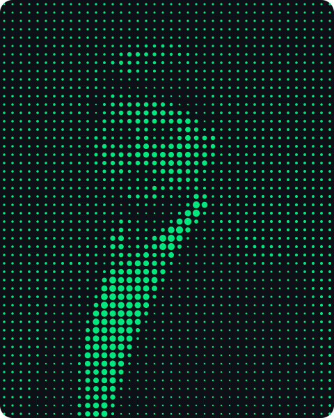
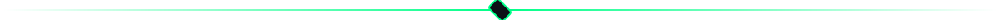
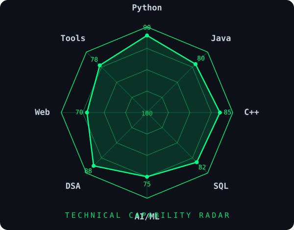

<div align="center">
  
</div>

<div align="center">
  
</div>

<div align="center">
  <a href="https://git.io/typing-svg"></a>
</div>

<div align="center">

**Building intelligent systems — from intrusion detection to school platforms**

<br/>


<br/><br/>

<a href="https://www.linkedin.com/in/muhammad-hayyan-khan-0a4b8437a/"></a>
&nbsp;&nbsp;
<a href="https://www.instagram.com/hayy4n_khan"></a>
&nbsp;&nbsp;
<a href="https://x.com/hayyan6776"></a>
&nbsp;&nbsp;
<a href="mailto:hayyan6776@gmail.com"></a>

</div>

<div align="center">
  
</div>

### About Me

CS undergraduate at **COMSATS University Islamabad** (2025–2029) who prefers **shipping products** over just writing code.

- **Currently:** Building **NHPS School Platform** — offline-first school management & parent communication system (React Native + NestJS + PostgreSQL)
- **AI Focus:** Intrusion detection with ML (**CyberShield**), image recognition (**Visionary**), LLM chat assistants (**Axiom AI**, **NOVA 2.0**)
- **Engineering:** Loves deep systems — Arch Linux daily driver, Docker, database internals
- **Open to:** Internships, collaborations, and ambitious ideas

### Currently

```yaml
building:    NHPS School Platform — offline-first attendance + Urdu parent app
learning:    Agentic AI · Query optimization · System design
os:          Arch Linux (KDE Plasma, Wayland) — fast systems, faster terminals
goal_2026:   Ship the school platform · AI internship · 50-star repo
```

<div align="center">
  
</div>

### Projects

<div align="center">

| | | |
|---|---|---|
| [**CyberShield**](https://github.com/HayyanKhan062/CyberShield-Network-Threat-Predictor) | **Visionary** | [**Axiom AI**](https://github.com/HayyanKhan062/Axiom-Ai-) |
| Network intrusion detection (NSL-KDD, Random Forest) | Flask image recognition (MobileNet-SSD + OpenCV) | ChatGPT-style assistant, deployed on Vercel |
| **NOVA 2.0** | [**ARAMS**](https://github.com/HayyanKhan062/ARAMS) | **Cricket Analytics Engine** |
| Rebranded chatbot, dark glassmorphism UI | Animal rescue management (Oracle + MongoDB, Java) | C++ DSA engine over 640-row dataset |

**NHPS School Platform** — *in progress:* full school management suite for 700+ students. 100% free stack.

</div>

<div align="center">
  
</div>

### Technical Capability

<div align="center">
  
</div>

<div align="center">

**Languages**
<br/>


**AI & Data**
<br/>


**Frameworks & Tools**
<br/>


</div>

<div align="center">
  
</div>

### GitHub Stats

<div align="center">
  
  
</div>

<div align="center">
  
</div>

<div align="center">
  
  <br/>
  <i>Profile crafted with precision — no templates were harmed.</i>
</div>
